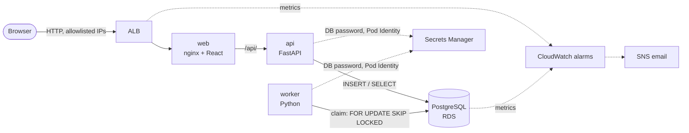

# Architecture

PulseQueue accepts telemetry events, evaluates each one against its threshold in a background
worker, and shows the results on a dashboard. It is small on purpose: the interest is in how it is
built, run, observed and torn down.

## Components

| Component | Role | Scaling and shutdown |
|---|---|---|
| `web` | Serves the React bundle; proxies `/api/` to the API | HPA 2–3 on CPU; 20 s preStop so the ALB stops sending traffic first |
| `api` | Accepts events (`202`), serves status and recent events | HPA 2–4 on CPU; drains requests for up to 20 s on `SIGTERM` |
| `worker` | Claims one pending event at a time and evaluates it | 2 replicas; finishes or rolls back the in-flight event on `SIGTERM` |
| `migrate` | Applies the idempotent schema | Helm pre-install/pre-upgrade hook; a failure stops the rollout |
| PostgreSQL | Stores events and is the queue | RDS `db.t4g.micro`, single-AZ, private, encrypted |

## Request and event flow

1. `POST /api/events` inserts a `pending` row and returns `202` with its ID. The API never
   evaluates events, so its latency does not depend on the worker.
2. A worker claims the oldest available row with `FOR UPDATE SKIP LOCKED`, evaluates it and marks
   it `processed` in the same transaction. Replicas never claim the same row, and if a worker dies
   its transaction rolls back and the event returns to the queue.
3. A failed evaluation is retried with exponential backoff (2, 4, 8, … up to 60 s). After 5 attempts
   the event is marked `failed` and kept for inspection.
4. The dashboard polls `/api/status` and `/api/events` every 5 s and keeps the last good data if a
   poll fails.

## Decisions and trade-offs

**Postgres as the queue, not SQS.** One dependency instead of two, and transactional claims.
Trade-off: throughput is limited by the database. Fine at this scale; a broker would be the next
step.

**Liveness and readiness are separate.** `/healthz` never checks dependencies, so a database
outage makes pods unready (no traffic) instead of restarting them (which would not help). The
worker has no traffic to gate, so its liveness is a heartbeat file the poll loop touches.

**EKS Pod Identity, not IRSA.** The AWS Free plan blocks creating OIDC providers. Pod Identity
needs none, and each role can be assumed only through an association naming one namespace and
service account. The app's role can read one secret and nothing else. Node IMDS is limited to one
hop, so pods cannot borrow the node role.

**The app reads the database password itself.** The API, worker and migration fetch it from
Secrets Manager whenever they open a connection, so RDS's password rotation needs no restart and
no Kubernetes Secret exists. Trade-off: an extra AWS call per new connection, and the app
connects as the database master user (a limited user is a follow-up). TLS to RDS uses
`verify-full` against Amazon's CA bundle baked into the image.

**Images: GHCR from CI, copied to ECR at deploy.** CI holds no AWS credentials: it publishes images
tagged with the commit SHA to GHCR, and only after a kind smoke test of those exact images passes.
`make deploy` copies them to ECR without changing their digests, and nodes pull with their own
role. Trade-off: an extra copy step, in exchange for no registry token in the cluster.

**Public access is an IP allowlist, over HTTP.** The EKS API and the ALB accept only
`api_allowed_cidrs`. There is no domain, so no certificate and no HTTPS.

**Observability is split by where it runs.** The app exposes Prometheus metrics and writes JSON
logs. Locally, Prometheus and Grafana run in Docker Compose with unit-tested alert rules. On AWS,
CloudWatch alarms use the ALB and RDS metrics AWS already collects, so monitoring needs no pods
in a cluster that has about two spare pod slots. Amazon Managed Grafana is not available on the
Free plan. Trade-off: on EKS, queue and worker metrics are visible only through `kubectl
port-forward`.

**ALB alarms use Metrics Insights.** The load balancer controller creates the ALB, so its ID is
unknown to Terraform and changes on every redeploy. The alarms query all ALBs in the project
instead, which is exact while the project has one.

**Cost and teardown come first.** One NAT gateway instead of one per AZ (cheaper; losing its AZ
cuts private egress). Two `t3.small` on-demand nodes (the Free plan blocks Spot and larger types;
each holds 11 pods). RDS is single-AZ with no final snapshot. `make tf-destroy` deletes the ingress
first and stops if the ALB cannot be released, because an orphaned ALB would block deleting the VPC.

## What is not here yet

- TLS and a domain (needs a Route 53 zone and an ACM certificate).
- A limited database user, and a schema migration tool for column changes.
- Remote Terraform state with locking; state is on one machine.
- Queue-depth autoscaling for the worker (KEDA would fit).
- Load testing of HPA scale-up, and a rotation test of the database password.
