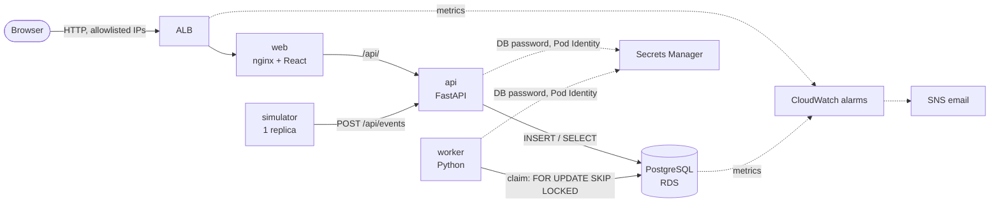

# Architecture

PulseQueue is the async event and webhook dispatch pipeline for a commerce platform. It accepts
events, delivers each one downstream from a background worker with retries, and shows delivery
health on an on-call console. Delivery is simulated, and a built-in scenario engine injects
realistic failures, so the metrics and alerts describe business impact: "30% of partner webhooks
are failing" rather than "a queue is slow". It is small on purpose: the interest is in how it is
built, run, observed and torn down.

| Event type | Share of traffic | p95 objective | Why |
|---|---|---|---|
| `payment.authorized` | 40% | 250 ms | A customer is waiting at checkout |
| `invoice.generated` | 20% | 500 ms | Ledger entry and PDF; nobody waits on it |
| `webhook.partner_notify` | 25% | 1 s | Partner endpoints time out; retries with backoff are expected |
| `inventory.reserve` | 15% | 300 ms | Holds stock while the order completes |

## Components

| Component | Role | Scaling and shutdown |
|---|---|---|
| `web` | Serves the React bundle; proxies `/api/` to the API | HPA 2–3 on CPU; 20 s preStop so the ALB stops sending traffic first |
| `api` | Accepts events (`202`), serves status and recent events | HPA 2–4 on CPU; drains requests for up to 20 s on `SIGTERM` |
| `worker` | Claims one pending event at a time and delivers it; one replica at a time also evaluates the console's alerts | 2 replicas; finishes or rolls back the in-flight event on `SIGTERM` |
| `simulator` | Sends synthetic events at the active scenario's rate | 1 replica, `Recreate`; no AWS role and no database access |
| `migrate` | Applies the idempotent schema | Helm pre-install/pre-upgrade hook; a failure stops the rollout |
| PostgreSQL | Stores events and is the queue | RDS `db.t4g.micro`, single-AZ, private, encrypted |

## Request and event flow

1. `POST /api/events` inserts a `pending` row and returns `202` with its ID. The API never
   delivers events, so its latency does not depend on the worker or on partners.
2. A worker claims the oldest available row with `FOR UPDATE SKIP LOCKED`, delivers it and marks
   it `processed` in the same transaction, recording the attempt in `attempts`. Replicas never
   claim the same row, and if a worker dies its transaction rolls back and the event returns to
   the queue.
3. A failed delivery is retried with exponential backoff (2, 4, 8, … up to 60 s). After 5 attempts
   the event is dead-lettered (`failed`) and kept for a day for inspection.
4. The console polls `/api/summary` and `/api/events` every 2 s, keeps two minutes of history for
   its sparklines, and keeps the last good data if a poll fails.

## The scenario engine

| Scenario | Traffic | Delivery behaviour |
|---|---|---|
| `healthy` | 10/s | 30–200 ms by type; under 0.5% failures |
| `downstream_degradation` | 10/s | Partner webhooks fail 30% and take 150–400 ms; everything else healthy |
| `retry_storm_backlog` | 12/s | Every type 300–900 ms; webhooks fail 50%. Two workers drain about 4/s |
| `recover` | 4/s | Healthy; switches itself back to `healthy` once queue lag is under 5 s and no rule breaches |

- **Where it lives:** one row in the `scenario` table. The console sets it with
  `PUT /api/scenario`. The simulator reads it for its rate, and the workers read it every 2 s for
  delivery behaviour. Every component sees the same scenario, and a pod restart does not reset it.
- **Fault injection sits in the worker's delivery step**, where a real partner call would be. That
  way retries, backoff, dead-lettering and metrics are the production code paths, not simulated
  ones. Outcomes are seeded by event ID and attempt, so a scenario fails the same events every
  time.
- **Alerts the console shows** are evaluated from Postgres by one worker at a time, holding an
  advisory lock. Each alert is pending, then firing, then resolved, kept for history. Rules: error
  rate above 5% per event type, p95 above the type's objective, queue lag above 30 s (critical),
  and any dead-lettered event. Each must hold for 30 s, except dead-lettering. Prometheus uses the
  same thresholds locally.
- **Queue lag** counts only events that are ready to run. An event waiting out a retry backoff is
  not late, so a partner outage does not look like a stuck queue.

## Decisions and trade-offs

**Postgres as the queue, not SQS.** One dependency instead of two, and transactional claims.
Trade-off: throughput is limited by the database. Fine at this scale; a broker would be the next
step.

**Liveness and readiness are separate.** `/healthz` never checks dependencies, so a database
outage makes pods unready (no traffic) instead of restarting them (which would not help). The
worker has no traffic to gate, so its liveness is a heartbeat file the poll loop touches.

**EKS Pod Identity, not IRSA.** The AWS Free plan blocks creating OIDC providers. Pod Identity
needs none, and each role can be assumed only through an association naming one namespace and
service account. The app's role can read one secret and nothing else. Node IMDS is limited to one
hop, so pods cannot borrow the node role.

**The app reads the database password itself.** The API, worker and migration fetch it from
Secrets Manager whenever they open a connection, so RDS's password rotation needs no restart and
no Kubernetes Secret exists. Trade-off: an extra AWS call per new connection, and the app
connects as the database master user (a limited user is a follow-up). TLS to RDS uses
`verify-full` against Amazon's CA bundle baked into the image.

**Images: GHCR from CI, copied to ECR at deploy.** CI holds no AWS credentials: it publishes images
tagged with the commit SHA to GHCR, and only after a kind smoke test of those exact images passes.
`make deploy` copies them to ECR without changing their digests, and nodes pull with their own
role. Trade-off: an extra copy step, in exchange for no registry token in the cluster.

**Public access is an IP allowlist, over HTTP.** The EKS API and the ALB accept only
`api_allowed_cidrs`. There is no domain, so no certificate and no HTTPS.

**The simulator is its own one-replica service.** Traffic stays constant when workers or the
API scale, which is exactly what the backlog demo needs: adding workers is the fix you can show.
It posts through the API, as a client would, so API metrics and the ALB see the traffic too. It
stops sending at 5,000 pending events, so a forgotten backlog demo cannot fill the disk.
Trade-off: one more pod, in a cluster with about two spare pod slots.

**The console evaluates its own alerts, from Postgres.** It works the same locally and on EKS,
where there is no Prometheus. Trade-off: the thresholds are defined twice, in
`apps/api/app/alerts.py` and `deploy/observability/alerts.yml`. Both are tested, and a comment in
each points to the other.

**Anyone who can open the console can change the scenario.** On AWS that is only the allowlisted
IPs. Set `simulator.allowSwitching=false` to make it read-only, or `simulator.enabled=false` to
remove the traffic.

**Observability is split by where it runs.** The app exposes Prometheus metrics and writes JSON
logs. Locally, Prometheus and Grafana run in Docker Compose with unit-tested alert rules. On AWS,
CloudWatch alarms use the ALB and RDS metrics AWS already collects, so monitoring needs no pods
in a cluster that has about two spare pod slots. Amazon Managed Grafana is not available on the
Free plan. Trade-off: on EKS, queue and worker metrics are visible only through `kubectl
port-forward`.

**ALB alarms use Metrics Insights.** The load balancer controller creates the ALB, so its ID is
unknown to Terraform and changes on every redeploy. The alarms query all ALBs in the project
instead, which is exact while the project has one.

**Cost and teardown come first.** One NAT gateway instead of one per AZ (cheaper; losing its AZ
cuts private egress). Two `t3.small` on-demand nodes (the Free plan blocks Spot and larger types;
each holds 11 pods). RDS is single-AZ with no final snapshot. `make tf-destroy` deletes the ingress
first and stops if the ALB cannot be released, because an orphaned ALB would block deleting the VPC.

## What is not here yet

- TLS and a domain (needs a Route 53 zone and an ACM certificate).
- A limited database user, and a schema migration tool for column changes.
- Remote Terraform state with locking; state is on one machine.
- Queue-depth autoscaling for the worker (KEDA would fit). The backlog scenario is the test for it.
- Authentication on the scenario switch.
- Load testing of HPA scale-up, and a rotation test of the database password.
